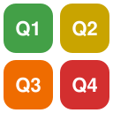
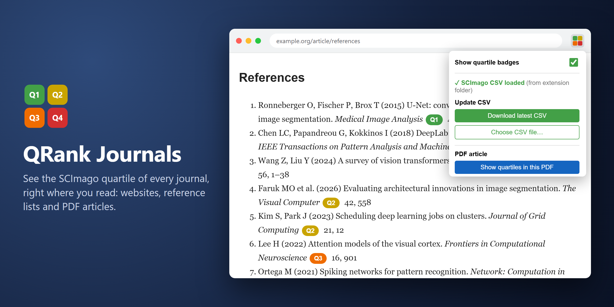
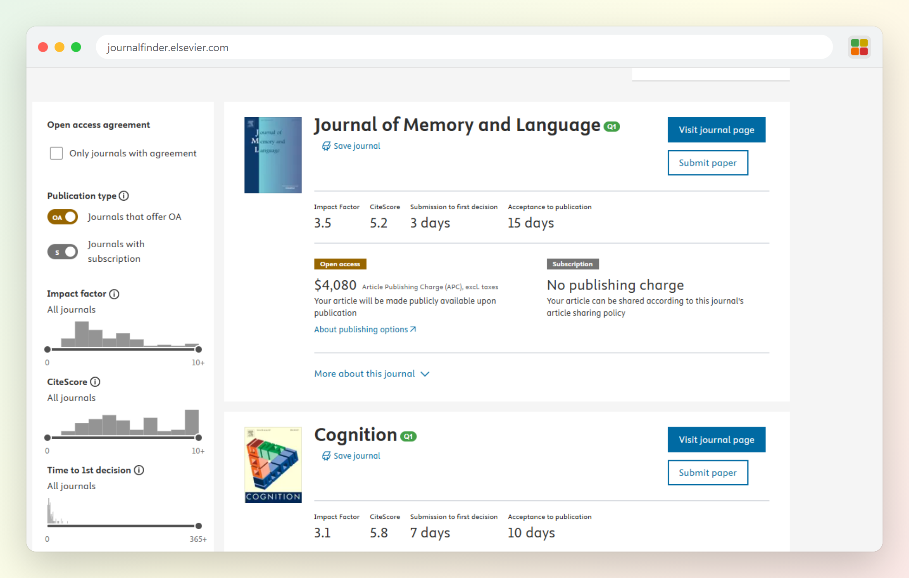
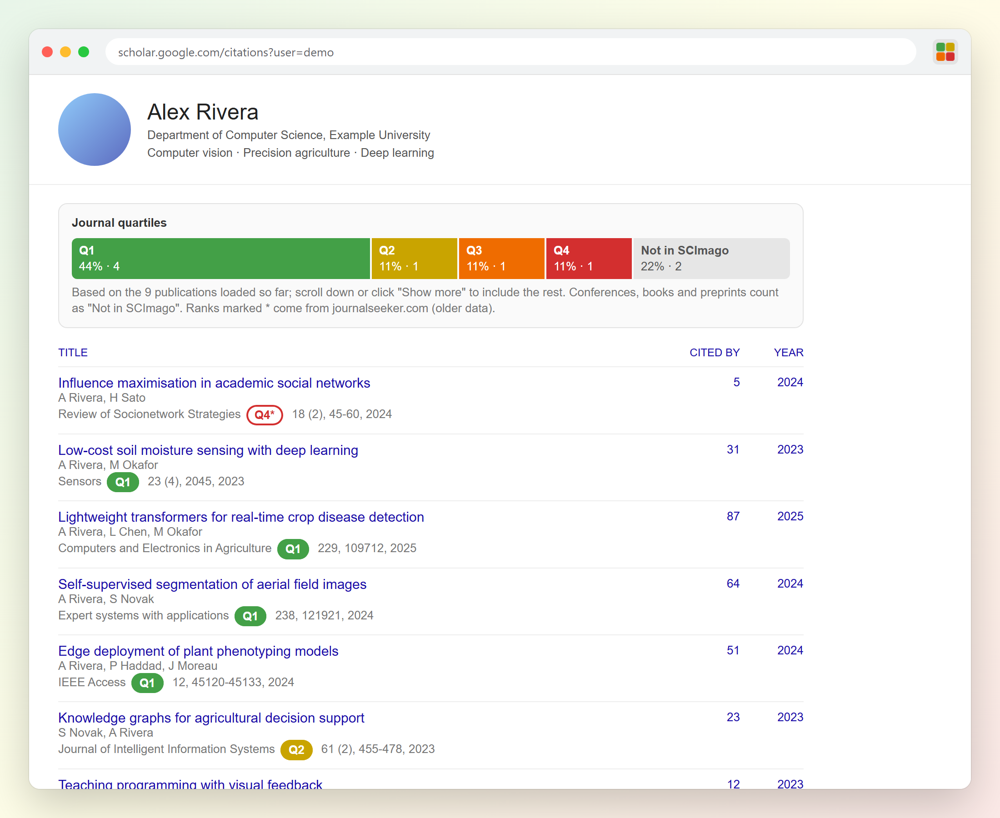
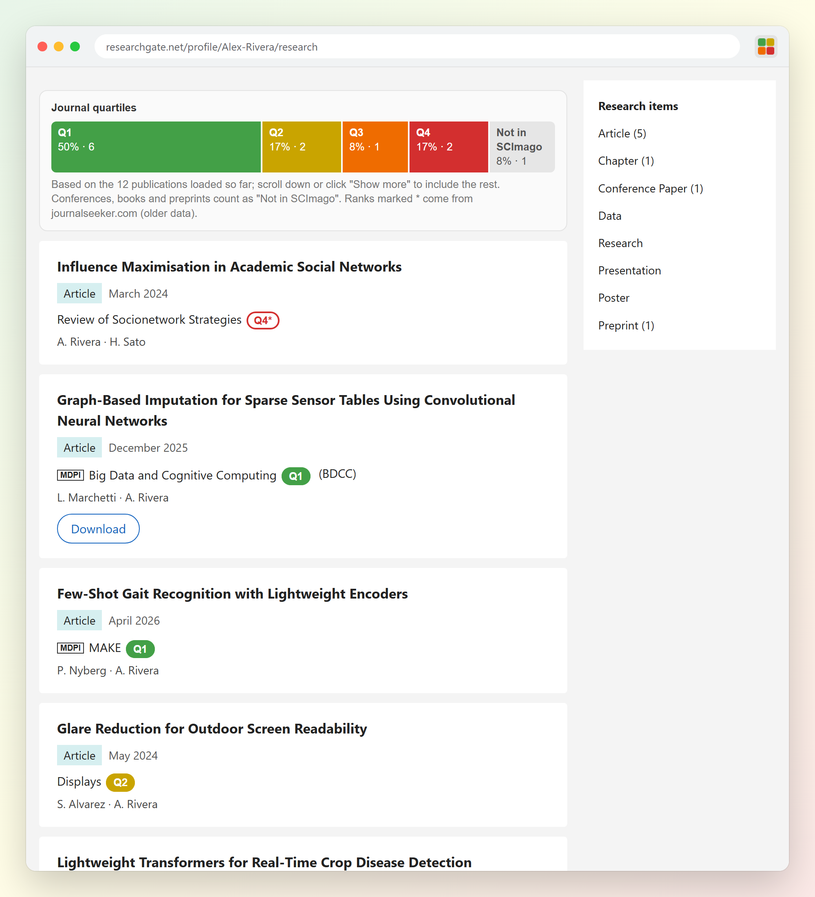
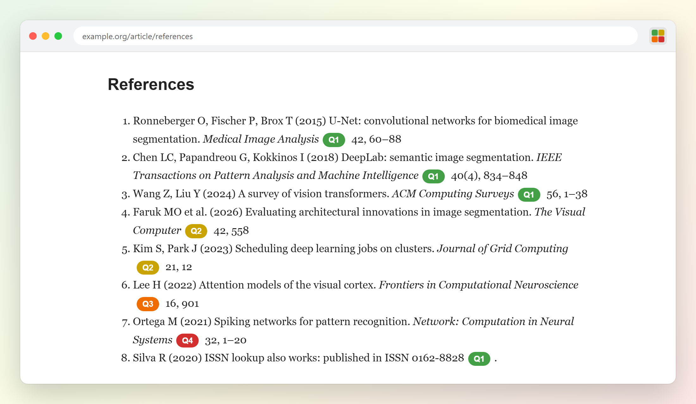
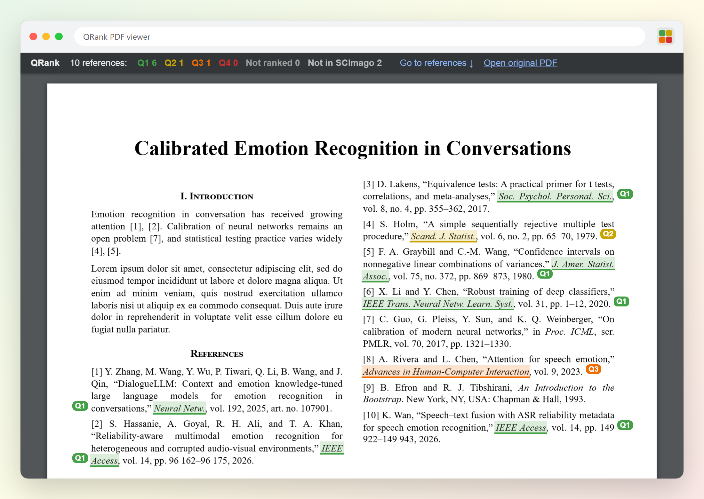
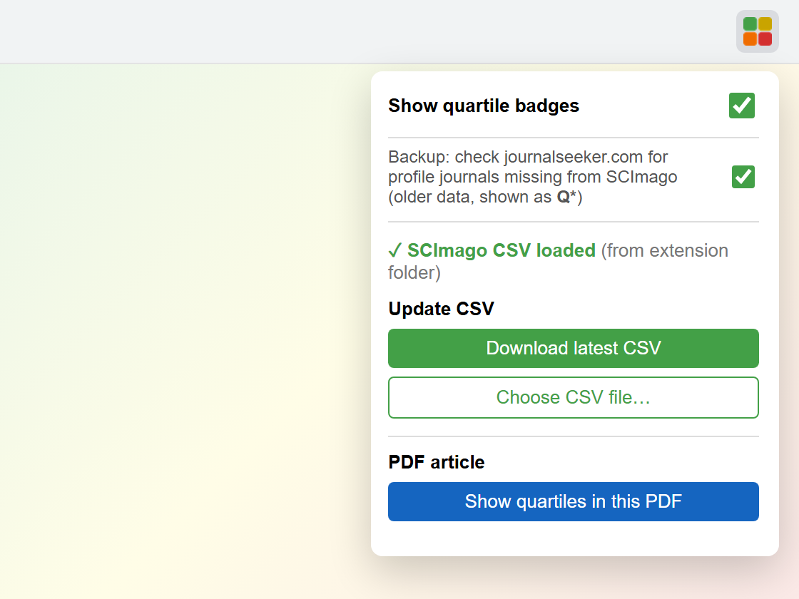
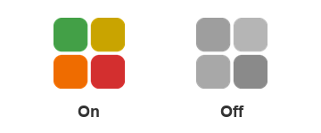

<h1 align="center">
   
  QRank Journals
</h1>

  <b>See the SCImago quartile (Q1–Q4) of every journal, right where you read.</b> 
  Websites, Scholar and ResearchGate profiles, reference lists and PDF articles. One glance, no copy-pasting into SCImago.

  
  
  
  
  

  
  &nbsp;
  

  

## ✨ Why QRank?

|  |  |
|---|---|
| 🎯 **Instant quartiles** | A coloured badge appears next to every journal name and ISSN it recognises. |
| 📊 **Profile summary** | On Google Scholar and ResearchGate profiles, a bar shows the share of Q1, Q2, Q3 and Q4 papers. |
| 📄 **PDF articles too** | One click marks every journal in a paper's References section, right inside the PDF. |
| 🔤 **Understands abbreviations** | *IEEE Trans. Neural Netw. Learn. Syst.*, *J. Amer. Statist. Assoc.*, ISSNs like *0162-8828*. |
| 🔒 **Private** | The journal list lives inside the extension, so pages are matched on your computer. Only journal names missing from SCImago are looked up online (see below). |
| 🛟 **Backup source** | A profile journal missing from SCImago is looked up on journalseeker.com and shown as an outlined **Q4\*** (older data). |
| 🖱️ **One click to SCImago** | Click any badge to open the journal's full SCImago page. |
| 🔘 **On / off switch** | Colourful icon when on, grey when off. |

  
  
  
  
  

## 🌍 See it in action

### Elsevier Journal Finder
Choosing where to submit? Every suggested journal shows its quartile next to the name.

### Google Scholar and ResearchGate profiles
Open anyone's profile and a **Journal quartiles** bar sums up their publications: how many in Q1, Q2, Q3, Q4, and how many outside SCImago (conferences, books, preprints). Every publication also gets its own badge, even when the journal is shown by a short name like *IoT* or *MAKE*: QRank looks up the journal's ISSN and finds it. A journal missing from the SCImago list is looked up on journalseeker.com and shown outlined with a star (**Q4\***), because that data is older.

Demo profiles with made-up papers and authors. The bar updates as you scroll or click *Show more*, and counts every publication loaded so far.

### Reference lists on article pages
Publisher pages like Springer and Elsevier, and any other page with a reference list.

### PDF articles
Open a paper, click **Show quartiles in this PDF**, and the same PDF comes back with each reference journal highlighted in its quartile colour, a badge beside it, and a summary at the top: *Q1 6 · Q2 1 · Q3 1*.

## 🚀 Install in 1 minute

Works in **Chrome, Brave and Edge**.

1. **[Download the ZIP](https://github.com/ismail-jabri-tech/qrank-journals/archive/refs/heads/main.zip)** and unzip it.
2. Open the extensions page by typing in the address bar:

   | Chrome | Brave | Edge |
   |---|---|---|
   | `chrome://extensions` | `brave://extensions` | `edge://extensions` |

3. Turn on **Developer mode** (switch at the top right).
4. Click **Load unpacked** and select the unzipped `qrank-journals-main` folder.
5. Click the puzzle icon 🧩 in the toolbar and pin **QRank Journals**.

That's it. Refresh any open page and the badges appear. 🎉

## 🧭 How to use it

Click the **QRank** icon in the toolbar:

- **Show quartile badges**: turn QRank on or off.
- **Backup: check journalseeker.com**: look up profile journals missing from SCImago (on by default).
- **Download latest CSV / Choose CSV file…**: update the journal list.
- **Show quartiles in this PDF**: mark the references of the PDF you are reading.

The icon tells you the state at a glance:

 

### 📄 PDF tips
- Works on any PDF article that has a **References** (or *Bibliography*) section. A PDF without one isn't an article, so it is left unchanged.
- Press **Back** to return to the normal PDF viewer, or use **Open original PDF** in the top bar.
- For PDFs saved on your computer, open QRank's **Details** on the extensions page and turn on **Allow access to file URLs**.

## 🔄 Keep the journal list up to date

The latest SCImago list (**2025**) is already included, so QRank works right away. When SCImago publishes new ranks (once a year):

1. Click the **QRank** icon → **Download latest CSV**.
2. On the SCImago page, click **Download data**.
3. Back in the popup, click **Choose CSV file…** and pick the downloaded file.

## ❓ FAQ

<b>Why is a journal not marked?</b>

It isn't in SCImago's list (for example, discontinued journals, most conferences and books) and the journalseeker.com backup doesn't know it either, or it's written with an unusual abbreviation like *Proc. Natl. Acad. Sci.* One-word journal names inside PDFs (*Bioinformatics*) are skipped on purpose, because plain text can't tell them apart from ordinary words.

<b>Does QRank send my browsing anywhere?</b>

Pages are matched on your computer against the CSV inside the extension; page text never leaves your browser. Two exceptions, both on profile pages: a ResearchGate journal page may be opened in the background to read its ISSN, and the name of a journal missing from SCImago is sent to journalseeker.com. Turn the backup off in the popup to keep everything local.

<b>Is it on the Chrome Web Store?</b>

Not yet. Install it with **Load unpacked** as shown above. It takes a minute and updates are just a new ZIP.

---

  Ranking data © <a href="https://www.scimagojr.com">SCImago Journal & Country Rank</a> · Backup ranks from <a href="https://journalseeker.com">journalseeker.com</a> · PDF rendering by <a href="https://mozilla.github.io/pdf.js/">PDF.js</a> (Apache 2.0, <code>lib/</code>) · Tests: <code>node test.js</code> 
  If QRank saves you time, give it a ⭐ so other researchers find it.

